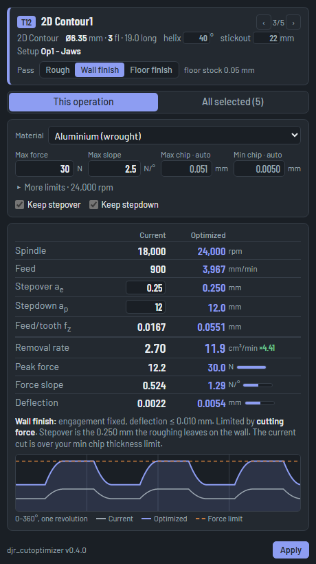
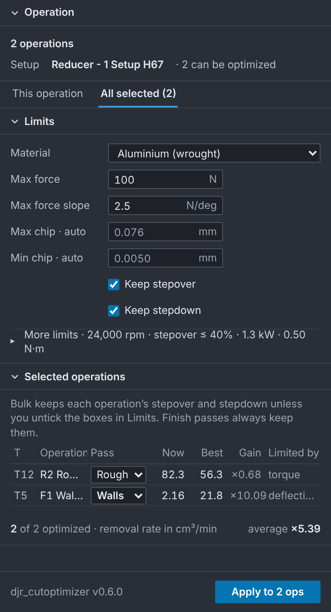

# DJR Cut Optimizer

A Fusion add-in that picks **feeds, speeds, stepover and stepdown** for your CAM operations. It gives the **highest removal rate** that stays inside limits you set: peak cutting force, how sharply the force rises as each flute enters the cut, chip thickness, tool deflection and your machine's limits.

Click an operation in the Manufacture browser, and a compact panel shows the current cut next to the best one inside your limits. Shift-select several operations (or a whole setup), mark each as rough, wall finish or floor finish, and **Apply** writes the suggested feeds and speeds to all of them.

> **Status: v0.4. Apply works in Fusion on a roughing operation** (checked on Windows). Finish passes, Revert and the other operation types are tested against a fake Fusion API only, and some CAM parameter names aren't verified on real operations yet. Apply reads every value back and puts an operation back if anything doesn't match, and **Revert** undoes the last Apply. Try it on a copy of a document first. See [Status](#status).

| One operation | All selected |
|---|---|
|  |  |

<sub>Renderings of the panel at Fusion's panel size, with a sample setup (a 1/4" 3-flute tool in 6061). They aren't Fusion screenshots.</sub>

## Install

1. Download **`djr_cutoptimizer-vX.Y.Z.zip`** from the [latest release](https://github.com/jayem1427/djr_cutoptimizer/releases/latest) (not the "Source code" zips) and unzip it. You get a folder named `djr_cutoptimizer`. Don't rename it.
2. Copy the folder into Fusion's add-ins folder:
   - **Windows:** `%APPDATA%\Autodesk\Autodesk Fusion 360\API\AddIns\`
   - **Mac:** `~/Library/Application Support/Autodesk/Autodesk Fusion 360/API/AddIns/`
3. Restart Fusion, or open **Utilities → Add-Ins → Scripts and Add-Ins** (Shift+S), select **djr_cutoptimizer**, click **Run**, and tick **Run on startup**.

To upgrade, replace the folder, then **Stop** and **Run** the add-in (or restart Fusion). Coming from v0.4.0 or earlier, restart Fusion once; older versions keep their code loaded through Stop/Run. Your limits live outside the folder and carry over.

## Use

1. In **Manufacture**, click **Optimize feeds & speeds** in the **Actions** panel. The panel opens on the right.
2. Click an operation in the CAM browser. The **card** at the top names what you're optimizing: tool number, operation, strategy, tool Ø, flutes, helix, stickout and setup. Below it is the current cut next to the best one inside your limits, with the removal-rate gain. It re-optimizes whenever you click another operation or change a limit.
3. **Bulk:** Shift- or Ctrl-click several operations, or click a whole setup, and open **All selected**. Each row shows the pass type, the removal rate now and the best, the gain, and what limits it. Operations the model doesn't cover say why. Click a row to open it.
4. The first time for each setup, pick the stock **material** and press **Confirm**. It's saved on the setup.
5. Check the tool's **helix** and **stickout** on the card. Fusion tools often lack them; values marked *assumed* are guesses (helix 35°, stickout 1.25 × flute length). Enter them once per tool. The **flute count** comes from the tool library, so make sure the tool is set up correctly there.
6. Set each operation's **pass**: **Rough**, **Wall finish** or **Floor finish** (see below).
7. Click **Apply** (or **Apply to N ops** in bulk), then click again within 4 s to confirm. Spindle speed and cutting feed are written and the toolpaths regenerate. **Revert** puts the last Apply back.

Tools and geometry are still assigned by hand in Fusion; the add-in only sets feeds, speeds and finishing stock.

**What stays fixed:** an adaptive keeps its stepdown, and a contour or slot keeps its stepover. A slot's stepover is always the tool diameter. Bulk keeps both. Untick **Keep stepover** / **Keep stepdown** to let the optimizer change them; Apply then writes them too.

### Rough and finish passes

| Pass | Engagement | Deflection limit | Apply also sets |
|---|---|---|---|
| **Rough** | as above | Max deflection, if set | nothing else; stock to leave is unchanged |
| **Wall finish** | fixed: stepover = the radial stock the roughing leaves | Finish deflection (0.01 mm) | stock to leave **0 radial, 0.05 mm axial**: stays off the floor |
| **Floor finish** | fixed: stepdown = the axial stock the roughing leaves | Finish deflection (0.01 mm) | stock to leave **0.05 mm radial, 0 axial**: stays off the walls |

- **Defaults.** A contour starts as a wall finish. An operation named with "rough", "floor", "wall" or "finish" follows its name. Everything else starts as rough. The choice is remembered per operation.
- **Finish engagement.** The roughing stock comes from the *selected* rough operations in the same setup, so select the roughing along with the finishing. If none is selected, the operation's own stepover/stepdown is used; type the real engagement under *Current* if that's wrong.
- The 0.05 mm is **Finish clearance**, and 0.01 mm is **Finish deflection**, both under *More limits*.

### What Apply changes

- Spindle speed and cutting feed, rounded down to whole rpm and mm/min.
- For rough passes, stepover/stepdown when you let the optimizer change them or typed them under *Current*.
- For finish passes, the stock-to-leave checkbox and the radial and axial stock.
- Not ramp, plunge, lead-in/out or other feeds.

Every value is read back after it's written. If Fusion refuses one, or it reads back differently, that operation goes back exactly as it was and the panel says why; the rest still apply. An operation is never half-changed.

A gain below ×1 is shown in amber. It means the current cut is over your limits, so the safe cut is slower.

## Limits

| Limit | Default | What it means |
|---|---|---|
| Max force | 30 N | Peak tangential force over one revolution (not the average). |
| Max slope | 2.5 N/° | Steepest rise in force per degree of rotation. It doesn't depend on rpm. Lower means gentler flute entry and less chatter. |
| Max chip | **auto** | Max chip thickness h<sub>ex</sub>. Blank uses the material table below × tool Ø. |
| Min chip | **auto** | Average chip h<sub>m</sub> below which the edge rubs. Blank uses the material table. |
| Max spindle | 24,000 rpm | Under *More limits*, with max feed, max deflection, the cutting-speed window, helix if unknown, and spindle power. |
| Max feed | none | **Set this** to what your machine can really do. With thin stepovers the model allows very high feeds, and the panel warns you when that happens. |
| Max deflection | none | Tool deflection at the peak force (see below). |
| Finish deflection | 0.01 mm | Deflection limit for wall and floor finish passes (the tighter of this and Max deflection wins). |
| Finish clearance | 0.05 mm | Stock a wall finish leaves on the floor, and a floor finish leaves on the walls. |

Your working limits are saved automatically. Save named sets (per machine, material or tool) under **More limits → Profile**.

### Chip thickness by material

Used when **Max chip** / **Min chip** are blank. For solid carbide end mills, max chip is a fraction of tool diameter. These are typical starting values from vendor chip-load charts, not a standard; check your tool maker's chart. For aluminium, 0.008 × D matches the common chart: 0.001" per tooth at 1/8" up to 0.004" at 1/2" ([Penn feeds and speeds guide](https://medesign.seas.upenn.edu/index.php/Guides/FeedsAndSpeeds)). Harder materials scale down in line with charts such as [Harvey Tool's](https://harveytool.com/resources/general-machining-guidelines) and [Amana's](https://www.amanatool.com/pub/media/productattachments/AlTiN-Mini-End-Mills-Speed-Chart-v4.pdf). Min chip is the typical rubbing threshold. It's higher for stainless and superalloys, which work-harden when the edge rubs.

| Material | k<sub>c1</sub> (N/mm²) | m<sub>c</sub> | Max chip | 1/4" tool | Min chip |
|---|---|---|---|---|---|
| Aluminium (wrought) | 295 | 0.25 | 0.008 × D | 0.051 mm | 0.005 mm |
| Aluminium (cast) | 345 | 0.25 | 0.007 × D | 0.044 mm | 0.005 mm |
| Brass / bronze | 550 | 0.25 | 0.006 × D | 0.038 mm | 0.005 mm |
| Copper | 900 | 0.25 | 0.005 × D | 0.032 mm | 0.008 mm |
| Grey cast iron | 1020 | 0.25 | 0.006 × D | 0.038 mm | 0.010 mm |
| Nodular cast iron | 1350 | 0.25 | 0.005 × D | 0.032 mm | 0.010 mm |
| Structural steel | 1780 | 0.21 | 0.005 × D | 0.032 mm | 0.010 mm |
| Carbon steel | 2000 | 0.21 | 0.005 × D | 0.032 mm | 0.010 mm |
| Alloy steel | 2260 | 0.20 | 0.004 × D | 0.025 mm | 0.010 mm |
| Tool steel (hardened) | 2900 | 0.20 | 0.0025 × D | 0.016 mm | 0.010 mm |
| Stainless (austenitic) | 2000 | 0.21 | 0.004 × D | 0.025 mm | 0.015 mm |
| Stainless (martensitic) | 2400 | 0.21 | 0.004 × D | 0.025 mm | 0.012 mm |
| Titanium alloy | 1500 | 0.25 | 0.003 × D | 0.019 mm | 0.012 mm |
| Nickel superalloy | 2650 | 0.25 | 0.003 × D | 0.019 mm | 0.015 mm |
| Plastic | 180 | 0.22 | 0.010 × D | 0.064 mm | 0.020 mm |

Only wrought aluminium k<sub>c1</sub> is calibrated (to Sandvik CoroPlus; cast aluminium is scaled from it). The other k<sub>c1</sub> values are uncalibrated reference values.

## How it works

The model is Sandvik Coromant's specific-cutting-force model, shared with [djr_cutcalculator](https://github.com/jayem1427/cutcalculator) through `web/optimizer.js`.

| Quantity | Formula |
|---|---|
| Average chip | h<sub>m</sub> = f<sub>z</sub>·sin κ<sub>r</sub>·(2a<sub>e</sub>/D) / φ, φ = arccos(1 − 2a<sub>e</sub>/D) |
| Max chip | h<sub>ex</sub> = f<sub>z</sub>·sin φ for a<sub>e</sub> < D/2, else f<sub>z</sub> |
| Specific force | k<sub>c</sub> = k<sub>c1</sub>·h<sub>m</sub><sup>−m<sub>c</sub></sup> |
| Force curve | exact integral of k<sub>c</sub>·f<sub>z</sub>·sin θ along each helical flute, sampled every 0.1° |
| Deflection | δ = F<sub>peak</sub>·L³ / (3·E·I), I = π(0.8·D)⁴/64, E = 600 GPa (carbide), L = stickout |

**The force graph** is the tangential force on the tool through one revolution, 0–360° left to right, 0 N at the bottom, a grid line every 90°. The filled curve is the optimized cut, the grey line the current cut, and the dashed line your force limit. Nothing is filtered or smoothed. It is the exact integral rather than the older sliced approximation, which added sawtooth spikes. Light, deep cuts at a smooth depth look nearly flat; that's real, not smoothing.

**Deflection** uses the peak force, not the mean force the calculator used, so it's the worst case through the revolution. A deflection limit becomes the force it allows at the tool's stickout.

**The optimizer:**

1. runs the spindle as fast as the rpm and cutting-speed limits allow;
2. for each stepover × stepdown on a grid, computes one force curve and solves for the largest feed per tooth every limit allows (force, slope and power all scale exactly with f<sub>z</sub><sup>1−m<sub>c</sub></sup>);
3. refines around the best point and re-checks it on a 0.05° force curve;
4. snaps the depth just under a whole multiple of the flute pitch πD/(z·tan β) when that's within 1% of the best. Force is nearly constant there, but only *just under*: go even 0.02 mm deeper and the full slope comes back.

## Known limitations

- **Planning values only.** Check every new cut conservatively.
- Adaptive toolpaths go above the nominal engagement in corners. The optimizer uses the nominal optimal load, so leave margin on the force limit.
- Forces are tangential only. The resultant force is typically 1.1–1.3× higher.
- Very thin stepovers allow very high feeds. Set **Max feed** to your machine's real limit.
- Drilling, boring, threading, chamfering, engraving and 3D finishing are refused, because the side-milling model doesn't cover them.

## Status

| | |
|---|---|
| Checked in Fusion (Windows) | The toolbar button and the panel load (v0.3). Reading a real 3D Adaptive roughing operation, and Apply on it in v0.4.1: spindle speed, feed and stepover were written, read back and the toolpath regenerated. That confirms `tool_spindleSpeed`, `tool_feedCutting` and `optimalLoad`. |
| Verified by tests | The model and optimizer against the Sandvik and HSM reference cuts (15 Node tests). 40 Python tests against a fake Fusion API: reading operations, expanding setups, skipping unsupported operations, storing the material, limit profiles, and no crash with no document, no CAM data or nothing selected. For Apply, they also cover the write plan for each pass type, read-back checks, rollback when Fusion refuses a value or a parameter is locked, partial bulk applies, and Revert. The panel itself (pass defaults, finish engagement, the two-click Apply, the payload sent to Fusion, Revert, bulk) is driven by a fake Fusion bridge in headless Chrome. |
| Not verified yet | Wall and floor finish passes (stock to leave), Revert, Apply on a pocket, contour or slot, and bulk Apply on several operations. |
| Unverified names | The other CAM parameter names in `commands/optimizer/cam_mapping.py`: `maximumStepdown` (read, not yet written), `radialStockToLeave`, `axialStockToLeave`, `stockToLeave`, `tool_bodyLength`, …. A wrong name makes Apply refuse that operation with a message; it doesn't write somewhere else. |

**Help verify the parameter names:** run the `djr_dump_cam_params` script from the release (Scripts tab → **+** → the unzipped folder → **Run**). Select an adaptive, a 2D contour (with stock to leave ticked), a 2D pocket and a slot first. Then commit its output to `docs/cam_params/`.

## Roadmap

- **Next.** Verify the parameter names against a real dump. Optionally scale the ramp and plunge feeds with the cutting feed.
- **Later.** Assign tools and geometry automatically. "Save as preset" into the tool library, and a hook into [djr_batchpost](https://github.com/jayem1427/djr_batchpost) to optimize and then post.

## Development

`web/panel.html` is the panel and lives here. `web/optimizer.js` is a copy from [jayem1427/cutcalculator](https://github.com/jayem1427/cutcalculator), the one source for the model; change it there, then copy it in.

```bash
python tools/sync_web.py            # copy optimizer.js from ../cutcalculator
python -m pytest                    # add-in tests (stdlib unittest; pytest optional)
node --test tests/web_optimizer.test.js
python tools/build_release.py       # dist/djr_cutoptimizer-vX.Y.Z.zip
```

To release, bump `"version"` in `djr_cutoptimizer.manifest` and `PLUGIN_VERSION` in `config.py`, then add a `## vX.Y.Z — date` section to `CHANGELOG.md`. Push to `main` and push a tag `vX.Y.Z`. The Release workflow runs the tests, builds both zips and publishes the release.

The images in `docs/images/` are renderings of `web/panel.html` in headless Chrome, at 460 × 820 in dark mode, with a fake Fusion bridge feeding sample operations.

## Credits and license

MIT. See [LICENSE](LICENSE). The model derives from [joevenzon/cutcalculator](https://github.com/joevenzon/cutcalculator) (MIT) via djr_cutcalculator. The add-in's structure follows [djr_batchpost](https://github.com/jayem1427/djr_batchpost).
