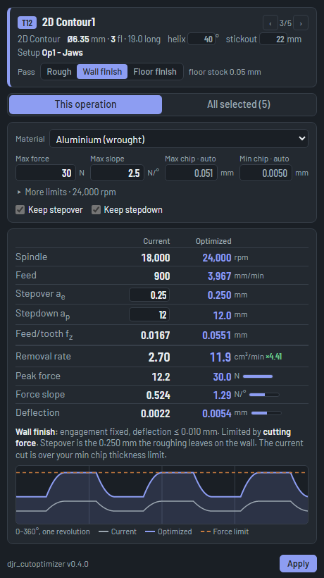
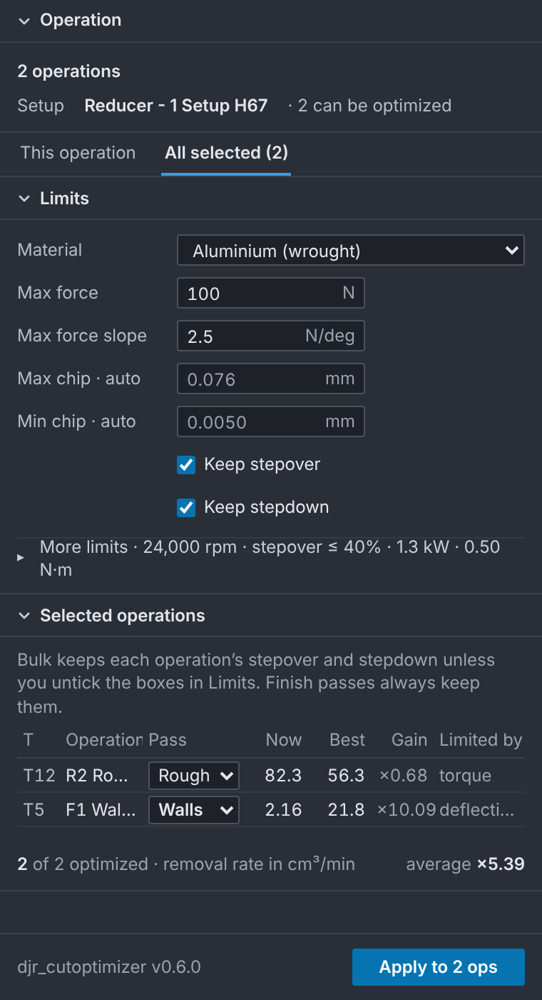

A Fusion add-in that picks **feeds, speeds, stepover and stepdown** for your CAM operations. It finds the **highest removal rate** that stays inside limits you set: peak cutting force, how sharply the force rises as each flute enters the cut, chip thickness, tool deflection and your machine's spindle and feed limits.

Click an operation in the Manufacture browser, and a panel shows the current cut next to the best one. Select several operations (or a whole setup), and **Apply** writes the new feeds and speeds to all of them and regenerates the toolpaths.

| One operation | All selected |
|---|---|
|  |  |

Renderings of the panel with a sample setup (a 1/4" 3-flute tool in 6061), not Fusion screenshots.
